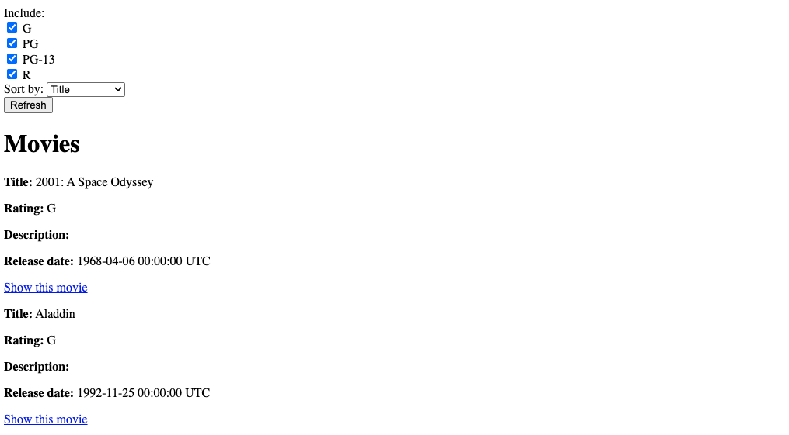

# Part 2: Sort the list of movies

First, let's make a new feature branch for the next step. This time, we're adding a sorting functionality, so consider naming your branch something relevant to the feature you'll be implementing. 

```sh
git checkout -b <NEW_BRANCH_NAME>
```

On the list of all movies page, add a drop-down with "Title" and "Release Date" as options. Selecting one of them and clicking the Refresh button should cause the list to be reloaded but sorted in ascending order on that column. For example, using the "release date" column should redisplay the list of movies with the earliest-released movies first; using the "Title" option should list the movies alphabetically by title. Use the database's ascending sort order; SQLite and PostgreSQL collations can differ, especially for punctuation and case. You can add this code right before the submit tag:

```erb
<div>
    <label class="form-label me-2" for="sort_by">Sort by:</label>
    <%= select_tag :sort_by,
                   options_for_select([["Title", "title"],
                                       ["Release date", "release_date"]],
                                       @sort_by),
                   id:    "sort_by",
                   class: "form-select d-inline w-auto" %>
</div>
```
**Note** Since this `<select>` is inside the same `form_with` as your checkboxes, when you press “Refresh”, it will submit both `params[:ratings]` and `params[:sort_by]` to the index action — no route changes needed.

When the listing page is redisplayed with sorting-on-a-column enabled, the option that was selected for sorting should appear in the drop-down.

The result should look something like this:



### Hint: displaying things in the right order

Databases are pretty good at returning collections of rows in sorted order according to one or more attributes. Before you rush to sort the collection returned from the database, look at the [documentation](https://api.rubyonrails.org/v8.1.4/) for `ActiveRecord.order` and see if you can get the database to do the work for you.

Only accept `"title"` and `"release_date"` as sort columns. Map these values to fixed column names and choose a default for missing or invalid values; never pass arbitrary `params[:sort_by]` directly to SQL or `Arel.sql`.

Don't put logic in your views! The view shouldn't have to sort the collection itself—its job is just to show stuff. The controller should spoon-feed the view exactly what is to be displayed.

## Deploying again

Use the same strategy as the last part to deploy. 

Check that it's working on the Render site!

----- 

Next: [Part 3: Remember the sorting and filtering settings](Part-3--Remember-the-sorting-and-filtering-settings.md)